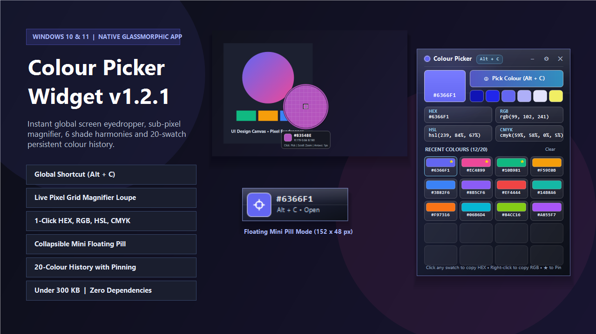
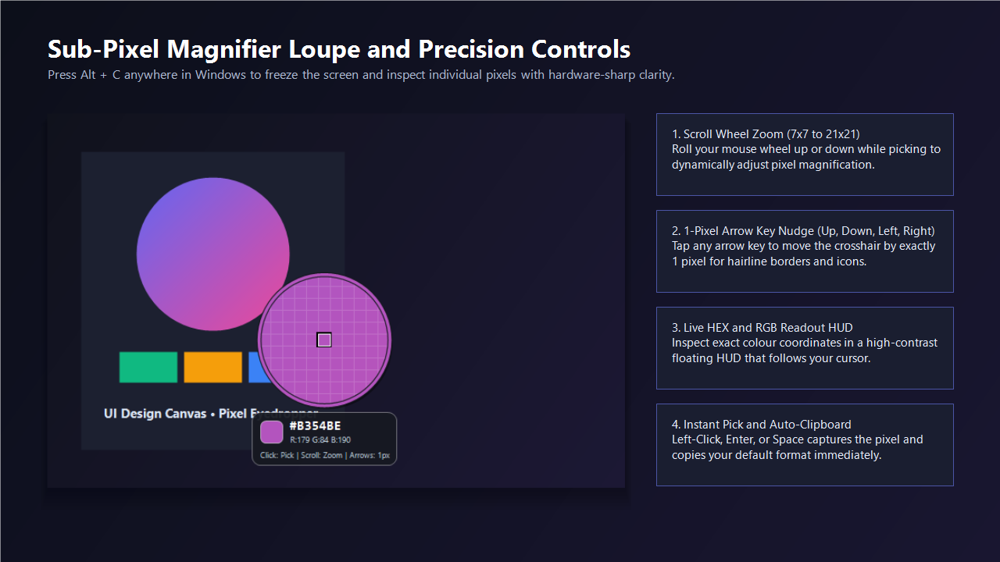
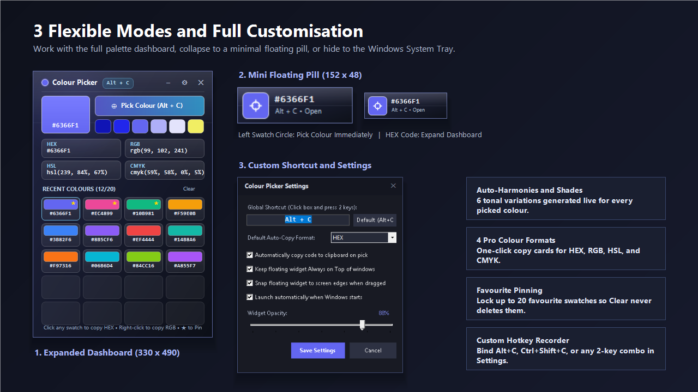

# Windows Colour Picker Widget (v1.2.1)

> **A lightweight, native glassmorphic floating widget and pixel-accurate global screen eyedropper for Windows 10 and Windows 11.**  
> Zero runtime installations required | `< 300 KB` footprint | Instant `Alt + C` global hotkey | 4 colour formats (`HEX`, `RGB`, `HSL`, `CMYK`) | Persistent 20-colour history with pinning.

---

## Key Features

### 1. Instant Global Hotkey (`Alt + C`) and Custom Shortcut Recorder
* Trigger the screen eyedropper from **anywhere in Windows**—whether you are working inside Figma, Photoshop, Blender, VS Code, or a web browser—even when the widget is collapsed into its Mini Pill or completely hidden in the System Tray.
* **Custom Two-Key Shortcut Recorder:** Open **Settings**, click the shortcut input box, and press any modifier + key combination (`Alt + C`, `Alt + Q`, `Ctrl + Shift + C`, ``Alt + ` ``, etc.) with built-in conflict detection (warns you if a `Shift + Letter` combination would interfere with typing capital letters).

### 2. Live Magnifier Loupe and Sub-Pixel Eyedropper

* **Real-Time Pixel Grid Loupe:** Displays a high-contrast magnified pixel grid right beside your cursor with live `HEX` and `R / G / B` readouts and a colour preview badge.
* **Scroll-Wheel Zoom:** Roll the **Mouse Scroll Wheel** up or down while picking to dynamically zoom the pixel inspection grid between **`7x7`** and **`21x21`** pixels.
* **1-Pixel Arrow Key Nudge:** Use the **Arrow Keys (`Up`, `Down`, `Left`, `Right`)** to move the crosshair by **1 exact pixel** at a time for razor-sharp edge and icon sampling.
* **One-Click Pick and Auto-Copy:** **Left-Click** (or press **`Enter` / `Space`**) to lock in the pixel colour, push it to the top of your history, and automatically copy it to your clipboard in your preferred format. Press **Right-Click** or **`Esc`** to cancel.

### 3. Three Flexible Workspace Modes

1. **Expanded Dashboard Mode (`330 x 490 px`)**
   * **Active Colour Header and Swatch:** Displays the active colour alongside a one-click **Pick Colour** button.
   * **6 Automatic Harmony and Shade Variations:** Instantly generates 6 tonal shades and harmonies of your active colour—click any strip to copy its `HEX` code and load it as the active colour.
   * **4 One-Click Format Copy Cards:** Displays live conversions for **`HEX`** (`#6366F1`), **`RGB`** (`rgb(99, 102, 241)`), **`HSL`** (`hsl(239, 84%, 67%)`), and **`CMYK`** (`cmyk(59%, 58%, 0%, 5%)`). Click any card to copy that specific format with instant toast feedback.
   * **20-Slot Recent Colour History Grid:** Visual swatches paired with `HEX` labels.
2. **Floating Mini Pill Mode (Collapse Button | `152 x 48 px`)**
   * Collapses the dashboard into a sleek, borderless floating pill that stays unobtrusively on top of your workspace and automatically **snaps to screen edges** when dragged.
   * **Click the Left Colour Circle** on the pill to immediately start picking a colour.
   * **Click the Right `HEX` Code Label** to expand back to the full dashboard.
3. **System Tray Stealth Mode (Close/Hide Button)**
   * Hides the widget completely off-screen into the **Windows System Tray** (with a dynamic tray icon coloured to match your last picked swatch).
   * Your global shortcut (`Alt + C`) remains active in the background at all times. Right-click or left-click the tray icon to pick a colour, switch between Expanded and Mini modes, open Settings, or exit.

### 4. Persistent 20-Colour History and Favourite Pinning
* Automatically remembers up to **20 recently picked colours** across reboots in `widget_data.json`.
* **Left-Click** any saved history tile to copy its `HEX` value and load its harmonies and formats into the dashboard.
* **Right-Click** any saved history tile to quickly copy its `RGB` value (`rgb(r, g, b)`).
* **Pin Favourites:** Click the top-right corner of any swatch to **Pin** it. Pinned colours are locked in place—they are never pushed out when new colours are picked and are protected when clicking **Clear**.

### 5. Customisable Settings and Native Windows Integration
* **Default Auto-Copy Format:** Choose whether picking a colour auto-copies `HEX`, `RGB`, `HSL`, or `CMYK`.
* **Adjustable Idle Opacity:** Fine-tune widget transparency from `40%` to `100%` (default `88%`).
* **Window Behaviour Toggles:**
  * *Automatically copy code to clipboard on pick*
  * *Keep floating widget Always on Top of windows*
  * *Snap floating widget to screen edges when dragged*
  * *Launch automatically when Windows starts* (via standard Windows CurrentUser Run registry entry)

---

## Installation and Package Contents

This release includes both a **Guided Setup Wizard** and a **Zero-Install Portable Executable**:

| File | Size | Description |
| :--- | :--- | :--- |
| **`ColourPickerSetup.exe`** | `~260 KB` | **Setup Wizard (Recommended):** Installs the widget to `%LocalAppData%\Programs\ColourPickerWidget` (or a custom folder), creates optional Desktop and Start Menu shortcuts, and includes a built-in Uninstaller (`Uninstall.exe`). |
| **`ColourPickerWidget_Portable.exe`** | `~145 KB` | **Standalone Portable App:** Run directly from any folder, external drive, or USB stick with zero installation. Stores `widget_data.json` right next to the executable. |
| **`README.md`** | `~4 KB` | Quick-start documentation and reference guide. |

### System Requirements
* **OS:** Windows 10 or Windows 11 (64-bit or 32-bit)
* **Dependencies:** **None.** Uses Windows' built-in native `.NET Framework` (`System.Windows.Forms` / `GDI+` / `DWM` Win32 APIs) pre-installed on every Windows 10 and 11 PC.

---

## Quick-Start Usage Guide

### Step 1 — Launch the App
* Run **`ColourPickerSetup.exe`** to install with Desktop and Start Menu shortcuts, **OR** double-click **`ColourPickerWidget_Portable.exe`** to run immediately in portable mode.

### Step 2 — Pick Any Pixel on Your Screen
1. Press **`Alt + C`** (or click **Pick Colour** on the dashboard, or click the **colour circle** on the Mini Floating Pill).
2. Move your cursor anywhere across your monitors. Watch the **Live Magnifier Loupe** inspect individual pixels in real time.
3. *(Optional)* Scroll your **Mouse Wheel** to zoom the pixel grid in or out, or tap the **Arrow Keys (`Up`, `Down`, `Left`, `Right`)** to nudge the crosshair by `1px`.
4. **Left-Click** (or press **`Enter` / `Space`**) to capture the colour. Its code is immediately copied to your clipboard and added to your history.

### Step 3 — Copy Formats, Shades and Pin Favourites
* Click any of the **6 shade and harmony bars** under the active swatch to explore lighter or darker tints and complementary tones.
* Click **`HEX`**, **`RGB`**, **`HSL`**, or **`CMYK`** cards to copy that exact syntax into your CSS, design tool, or print specification.
* Click the **Pin icon** in the top-right of any swatch in **Recent Colours (`20/20`)** to lock your project's core brand palette so it never gets overwritten.

---

## Controls and Shortcuts Cheat Sheet

| Context | Action / Shortcut | Result |
| :--- | :--- | :--- |
| **Anywhere in Windows** | `Alt + C` *(Customisable)* | Activate full-screen Eyedropper and Magnifier Loupe |
| **During Screen Pick** | `Left-Click` / `Enter` / `Space` | Pick pixel colour and copy to clipboard |
| **During Screen Pick** | `Mouse Scroll Wheel` | Zoom magnifier pixel grid (`7x7` to `21x21`) |
| **During Screen Pick** | `Up` `Down` `Left` `Right` Arrow Keys | Nudge cursor by `1px` for pixel-perfect precision |
| **During Screen Pick** | `Right-Click` / `Esc` | Cancel screen colour picking |
| **Expanded Dashboard** | Click `HEX` / `RGB` / `HSL` / `CMYK` | Copy colour in selected format |
| **Expanded Dashboard** | Click Harmony / Shade Strip | Set shade as active colour and copy `HEX` |
| **History Grid** | `Left-Click` Swatch | Copy `HEX` and load as active colour |
| **History Grid** | `Right-Click` Swatch | Copy `RGB` string (`rgb(r, g, b)`) |
| **History Grid** | Click Top-Right Pin on Swatch | Pin / Unpin colour (protects from *Clear* and queue overflow) |
| **Widget Header** | Collapse / Settings / Hide Buttons | Collapse to Mini Pill / Open Settings / Hide to System Tray |
| **Mini Floating Pill** | Click Left Colour Circle | Immediately trigger Screen Eyedropper |
| **Mini Floating Pill** | Click Right `HEX` Text | Expand back to Full Dashboard |

---

## License

Free to use for personal and commercial design and development workflows.
